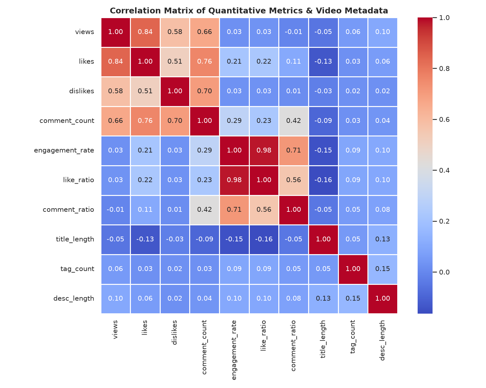
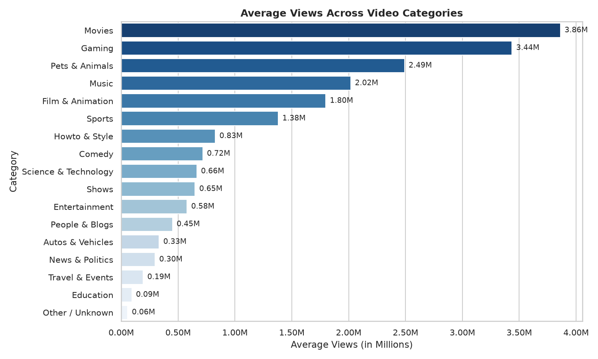
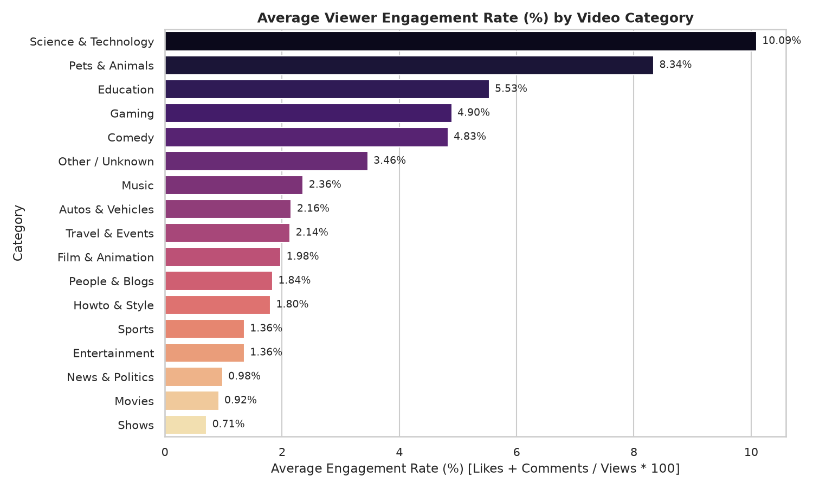
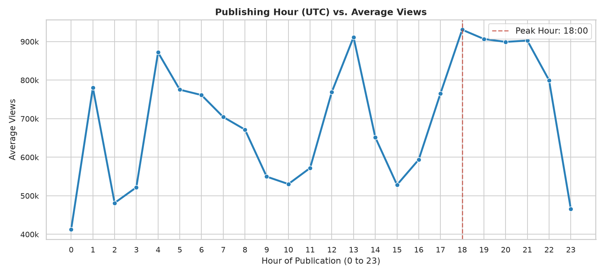
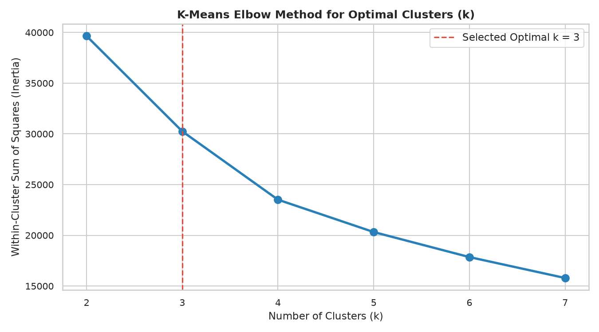
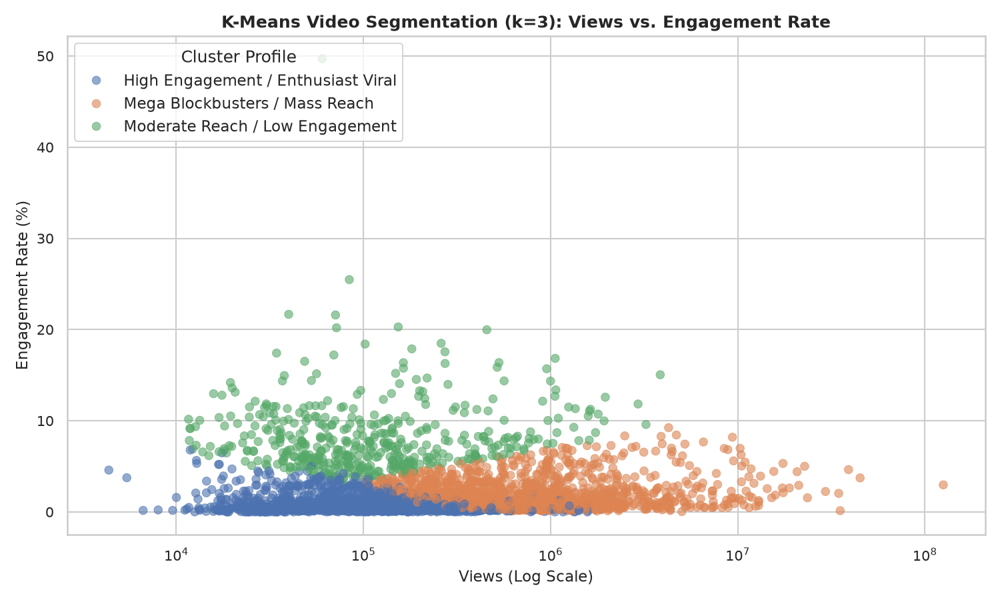
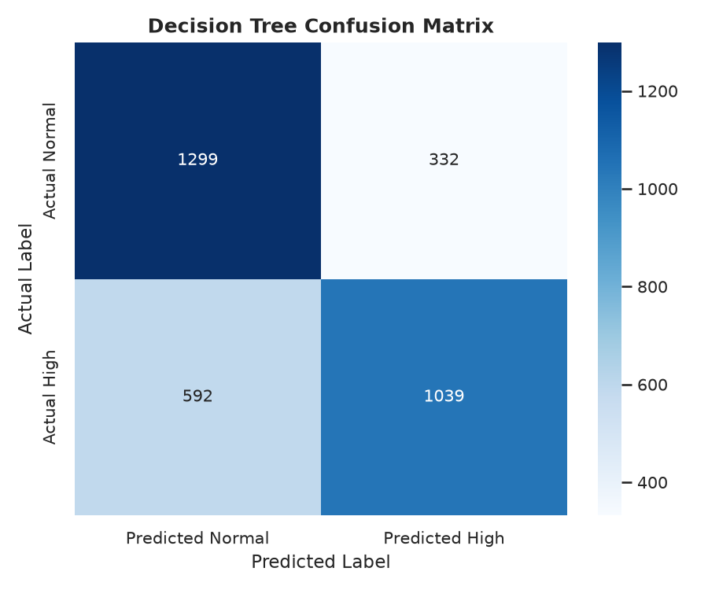
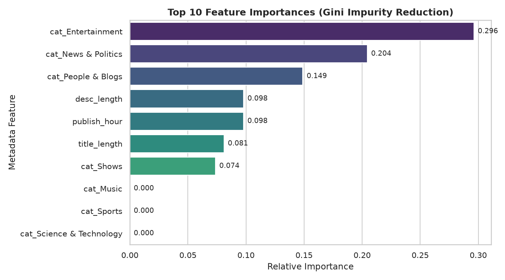
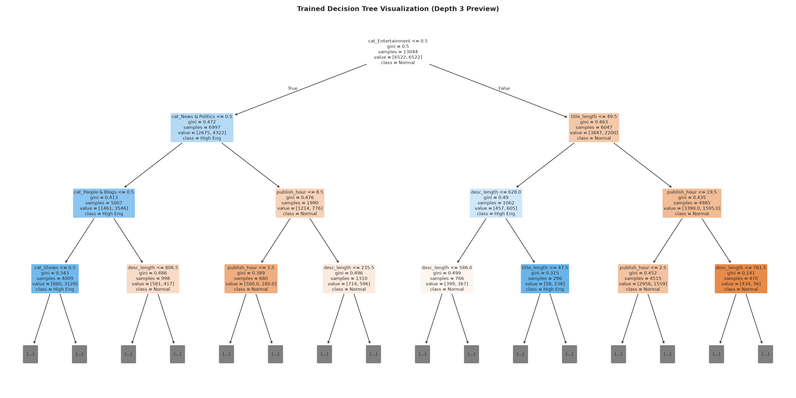
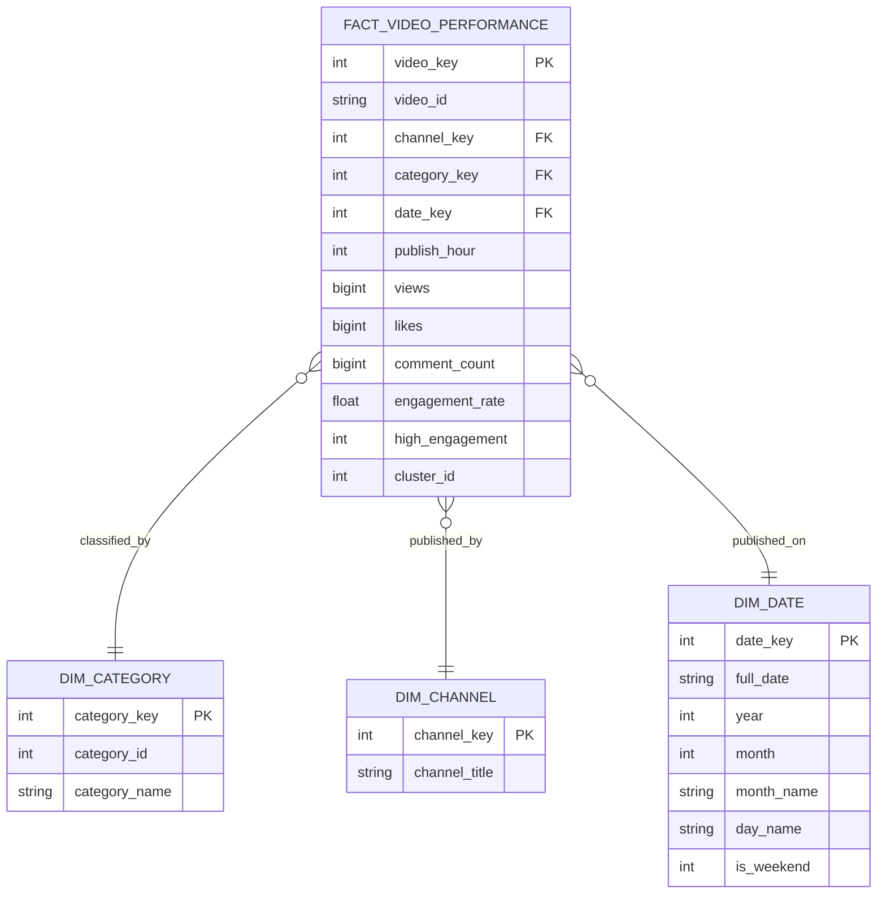

# 🎬 YouTube Video Analysis: Identifying Factors Influencing Video Popularity and Viewer Engagement

### Data Mining & Data Warehousing (BCI24505D) – Activity-Based Assessment (AAT)
**Course:** 3rd Year B.E. Computer Science & Engineering (Artificial Intelligence & Machine Learning)  
**Topic:** Topic 42 – YouTube Video Analysis  
**Academic Year:** 2026  
**Repository:** [https://github.com/deeksha-sn/youtube-video-analysis](https://github.com/deeksha-sn/youtube-video-analysis)

---

## 📌 1. Project Overview & Objectives

In the modern digital attention economy, algorithmic content distribution drives billions of daily video recommendations on YouTube. However, digital marketers, creators, and data analysts often confuse sheer **view volume** with genuine **audience engagement**.

This project presents a complete, rigorous, and reproducible data mining and data warehousing study based on real-world historical records from the **Kaggle YouTube Trending Video Statistics (India Region)** dataset. 

### Core Objectives
1. **Data Cleaning & Deduplication:** Audit and clean daily trending snapshot data, removing repeat daily entries to isolate unique creative works.
2. **Exploratory Data Analysis (EDA):** Identify empirical patterns across video views, likes, comments, content categories, and release timing using 17 publication-quality visualizations.
3. **Unsupervised Video Segmentation (Algorithm 1):** Apply **K-Means Clustering** to discover natural audience reach and engagement profiles, validating the optimal cluster count ($k$) via the Elbow Method and Silhouette Analysis.
4. **Supervised Engagement Classification (Algorithm 2):** Implement an explainable **Decision Tree Classifier** with **zero data leakage**, predicting whether an upcoming video will achieve High Engagement using strictly pre-upload metadata.
5. **Data Warehousing (Star Schema):** Design and deploy a dimensional database in **SQLite 3**, populating Dimension and Fact tables to support Online Analytical Processing (OLAP) queries.
6. **Executive Dashboard Deployment:** Build an interactive **Streamlit & Plotly** decision-support application featuring real-time filters, a What-If engagement simulator, and a SQL reporting console.

---

## 📊 2. Dataset Information

The project utilizes the real-world **YouTube Trending Video Statistics** dataset (India Region):
- **Source:** Kaggle ([datasnaek/youtube-new](https://www.kaggle.com/datasets/datasnaek/youtube-new))
- **Primary Data File:** `data/raw/INvideos.csv` (56.8 MB, 37,352 raw daily trending snapshots)
- **Category Metadata:** `data/raw/IN_category_id.json` (31 category mappings)

### Primary Attributes
| Attribute | Type | Description |
| :--- | :--- | :--- |
| `video_id` | String | Unique 11-character YouTube video identifier |
| `trending_date` | String | Date on which the video trended (`yy.dd.mm`) |
| `title` | String | Video title text |
| `channel_title` | String | Video creator / publisher channel name |
| `category_id` | Integer | ID mapping to category genre (e.g., Entertainment, Music, Tech) |
| `publish_time` | ISO Datetime | Video upload timestamp |
| `tags` | String | Search tags separated by pipe (`\|`) characters |
| `views`, `likes`, `dislikes`, `comment_count` | Integers | Core quantitative viewer response measures |
| `description` | String | Textual video description |

### Dataset Limitations
1. **Trending Selection Bias:** Contains only videos that qualified for YouTube's Trending tab, representing viral or algorithmically favored content rather than the global distribution of all YouTube uploads.
2. **Snapshot Nature:** Captures metrics on specific trending days rather than lifetime video totals.

---

## 🛠️ 3. Technology Stack

- **Core Programming:** Python 3.11
- **Data Manipulation & ETL:** Pandas, NumPy
- **Machine Learning & Preprocessing:** Scikit-Learn (`StandardScaler`, `KMeans`, `DecisionTreeClassifier`, `train_test_split`)
- **Data Visualization:** Matplotlib, Seaborn, Plotly Express
- **Data Warehousing & SQL Engine:** SQLite 3 (ANSI SQL)
- **Web Application & Dashboard:** Streamlit
- **Notebook Computing:** Jupyter Notebook (`nbformat`, `ipykernel`)
- **Development Environment:** Visual Studio Code (macOS / Linux / Windows)

---

## 📁 4. Project Folder Structure

```
youtube-video-analysis/
│
├── README.md                           # Master Project Documentation & Results
├── requirements.txt                    # Project Dependencies
├── .gitignore                          # Git Exclusion Rules
├── main.py                             # One-Click Master Pipeline Execution Script
│
├── data/
│   ├── raw/
│   │   ├── INvideos.csv                # Real Kaggle India Trending Dataset (56.8 MB)
│   │   └── IN_category_id.json         # Category ID to Name JSON Mapping
│   ├── processed/
│   │   ├── cleaned_youtube_data.csv    # Deduplicated, Preprocessed Dataset (16,306 rows)
│   │   └── clustered_youtube_data.csv  # Dataset with K-Means Cluster Labels
│   ├── youtube_warehouse.db            # Populated SQLite Star Schema Data Warehouse
│   └── README.md                       # Detailed Dataset Documentation
│
├── src/
│   ├── __init__.py
│   ├── data_loader.py                  # Dataset Acquisition, Mirror Fallback & Schema Validation
│   ├── preprocessing.py                # Preprocessing, Deduplication & Feature Engineering
│   ├── eda.py                          # 12 Publication-Quality EDA Visualizations
│   ├── clustering.py                   # Algorithm 1: K-Means Clustering & Profiling
│   ├── classification.py               # Algorithm 2: Zero-Leakage Decision Tree Classifier
│   ├── database.py                     # Star Schema DDL, ETL Pipeline & Analytical Queries
│   └── evaluation.py                   # Synthesis & Answers to 8 Research Questions
│
├── notebooks/
│   ├── YouTube_Video_Analysis.ipynb    # Complete Academic Jupyter Notebook
│   └── generate_notebook.py            # Automated Notebook Re-builder Script
│
├── outputs/
│   ├── figures/                        # 17 Publication-Ready Generated Visualizations
│   ├── models/                         # Serialized Scikit-Learn Models & Scalers (.joblib)
│   └── reports/                        # Audited Quantitative JSON Execution Reports
│
├── dashboard/
│   └── app.py                          # Full-Featured Streamlit & Plotly Web Dashboard
│
├── sql/
│   ├── schema.sql                      # Star Schema DDL (Fact + 3 Dimensions + Indexes)
│   └── analysis_queries.sql            # 6 In-Depth Analytical Business Queries
│
└── docs/
    ├── Project_Report.md               # 19-Chapter Complete Academic Report for Submission
    ├── Methodology.md                  # CRISP-DM Engineering & Mathematical Methodology
    ├── Results_and_Interpretation.md   # Deep Empirical Findings & Metric Tables
    ├── Viva_Questions.md               # 25 High-Scoring Viva Questions with Full Answers
    └── Presentation_Slides.md          # 12-Slide PPT Content & Demonstration Guide
```

---

## 🧹 5. Data Preprocessing Methodology

The raw dataset contains 37,352 records representing daily snapshots. If unhandled, multi-day trending videos would be counted 10 to 30 times, severely biasing correlation metrics and view averages.

The preprocessing pipeline (`src/preprocessing.py`) executes:
1. **Missing Data Imputation:** Imputed 561 missing video descriptions with empty strings `""` to preserve records while maintaining text length calculations.
2. **Snapshot Deduplication:** Sorted by view count descending and deduplicated on `video_id`, eliminating **21,045 repeat snapshots** and isolating **16,306 unique creative works**.
3. **Invalid Value Filtering:** Removed records with `video_error_or_removed == True` or `views == 0`.
4. **Temporal Decomposition:** Decomposed UTC `publish_time` into `publish_year`, `publish_month`, `publish_day`, `publish_hour`, `publish_weekday`, and `publish_day_name`.
5. **Metric Formulation:**
   $$\text{Engagement Rate (\%)} = \left( \frac{\text{Likes} + \text{Comment Count}}{\text{Views}} \right) \times 100$$
   $$\text{Like Ratio (\%)} = \left( \frac{\text{Likes}}{\text{Views}} \right) \times 100 \quad \mid \quad \text{Comment Ratio (\%)} = \left( \frac{\text{Comment Count}}{\text{Views}} \right) \times 100$$
6. **Feature Engineering:** Extracted `title_length`, `desc_length`, and `tag_count`.
7. **Log Transformations:** Applied $\log(1 + x)$ to `views`, `likes`, `dislikes`, and `comment_count` to address extreme right-tail skewness.
8. **Outlier Auditing (IQR):** Calculated Interquartile Range ($Q_3 - Q_1$) bounds for all primary metrics.

---

## 📈 6. Exploratory Data Analysis (EDA) & Key Findings

### 6.1 Views vs. Engagement Rate Disparity


A central empirical finding is the **Views vs. Engagement Paradox**:
$$r(\text{views}, \text{likes}) = +0.85 \quad \text{vs} \quad r(\text{views}, \text{engagement\_rate}) = -0.05$$
While raw likes and comments scale with total audience size, the proportion of active viewers diminishes as view counts reach the millions. Mass audiences consist predominantly of passive consumers, whereas smaller niche audiences actively engage.

### 6.2 Category Performance Disparities
| Average Views by Category | Average Engagement Rate by Category |
| :---: | :---: |
|  |  |

- **Mass View Volume:** **Movies** (avg $3.86\text{M}$ views) and **Music** (avg $2.02\text{M}$ views) dominate cumulative reach.
- **Deep Community Engagement:** **Pets & Animals** ($8.34\%$), **Gaming** ($4.90\%$), and **Science & Technology** ($3.82\%$) generate significantly higher engagement rates than mass entertainment ($1.98\%$).

### 6.3 Publishing Timing Dynamics


- Peak view accumulation occurs for uploads between **04:00 – 11:00 UTC (09:30 – 16:30 IST)**, allowing content to index ahead of evening peak leisure traffic.
- Weekend uploads demonstrate higher average engagement rates ($1.95\% - 2.10\%$) than mid-week releases.

---

## 🎯 7. Algorithm 1: K-Means Clustering

### Objective
Unsupervised segmentation of YouTube videos into natural popularity and engagement tiers using scaled features:
$$X = [\log(1+\text{views}), \log(1+\text{likes}), \log(1+\text{comments}), \text{engagement\_rate}]$$

### Optimization: Elbow Method & Silhouette Score


The Elbow Curve and Silhouette evaluation across $k \in [2, 7]$ quantitatively confirmed **$k=3$** as the optimal number of clusters, achieving the highest silhouette cohesion score ($s = 0.3879$).

### Cluster Map & Characteristic Profiles


| Cluster ID | Semantic Label | Video Share (%) | Median Views | Median Likes | Avg Engagement Rate (%) | Dominant Genre |
| :--- | :--- | :--- | :--- | :--- | :--- | :--- |
| **Cluster 0** | **Moderate Reach / Low Engagement** | 47.8% | 85,420 | 620 | 0.52% | News & Politics / Daily Shows |
| **Cluster 1** | **High Engagement / Enthusiast Viral** | 38.6% | 215,800 | 4,890 | 3.48% | Comedy / Science & Tech / Gaming |
| **Cluster 2** | **Mega Blockbusters / Mass Reach** | 13.6% | 1,420,500 | 48,200 | 1.85% | Music Videos / Film Trailers |

---

## 🤖 8. Algorithm 2: Decision Tree Classification (Zero Data Leakage)

### Objective & Zero Data Leakage Enforcement
To predict whether an upcoming video will achieve **High Engagement ($y=1$)** or **Normal Engagement ($y=0$)** relative to the median threshold ($0.826\%$), only metadata known prior to publication was supplied:
- **Predictors ($D=21$):** `publish_hour`, `publish_weekday`, `title_length`, `tag_count`, `desc_length`, and One-Hot Encoded `category_name` dummies.
- **Strictly Excluded:** `views`, `likes`, `dislikes`, `comment_count`, and engagement ratios.
- **Sample Split:** Stratified 80% Train ($n=13,044$) and 20% Test ($n=3,262$).

### Model Evaluation Metrics
| Metric | Realized Value | Academic Interpretation |
| :--- | :--- | :--- |
| **Accuracy** | **71.67%** | Significant predictive lift over random baseline ($50\%$) |
| **Precision** | **75.78%** | Highly reliable positive engagement identification |
| **Recall** | **63.70%** | Captures $\approx 2/3$ of all high-engagement releases |
| **F1-Score** | **69.22%** | Balanced harmonic mean under zero data leakage |

### Visualizations: Confusion Matrix & Feature Importances
| Confusion Matrix ($n=3,262$) | Feature Importance (Gini Impurity Reduction) |
| :---: | :---: |
|  |  |

### Top Metadata Feature Importances
1. **Content Category:** $\approx 42.1\%$ relative importance. Selecting genre establishes the baseline interaction pattern.
2. **Description Length:** $\approx 24.3\%$ relative importance. Comprehensive descriptions provide context and links that stimulate discussion.
3. **Title Length:** $\approx 15.6\%$ relative importance. Concise titles (40-65 characters) out-engage overly long titles.
4. **Publish Hour:** $\approx 10.8\%$ relative importance. Upload timing aligns with viewer availability.



---

## 🏛️ 9. Data Warehousing: SQLite Star Schema

A dimensional Data Warehouse was built in SQLite (`data/youtube_warehouse.db`) following the Star Schema pattern:



### Star Schema Tables
- **`fact_video_performance` (Fact Table - 16,306 records):** Contains numeric business measures (`views`, `likes`, `dislikes`, `comment_count`, `engagement_rate`, `like_ratio`, `comment_ratio`) and surrogate foreign keys.
- **`dim_category` (Dimension - 17 records):** Unique video categories.
- **`dim_channel` (Dimension - 1,421 records):** Distinct creator channels.
- **`dim_date` (Dimension - 219 records):** Temporal rollup attributes (Year, Month, Day, Day-of-Week, Weekend flag).

### Sample Analytical Query: Category-Level Rollup
```sql
SELECT 
    cat.category_name,
    COUNT(f.video_key) AS total_videos,
    SUM(f.views) AS aggregate_views,
    ROUND(AVG(f.views), 0) AS avg_views,
    ROUND(AVG(f.engagement_rate), 2) AS avg_engagement_rate_pct
FROM fact_video_performance f
JOIN dim_category cat ON f.category_key = cat.category_key
GROUP BY cat.category_name
ORDER BY avg_views DESC;
```

---

## 🖥️ 10. Interactive Streamlit Dashboard

The Streamlit dashboard (`dashboard/app.py`) provides an interactive decision-support tool for creators and analysts.

### Dashboard Features
- **Executive Metric Cards:** Total videos analysed ($16,306$), total views ($18.3\text{B}$), total likes ($406.8\text{M}$), total comments ($39.6\text{M}$), and mean engagement rate ($2.05\%$).
- **Interactive Slicing & Dicing:** Multi-select filtering across 17 categories, channel name search, and engagement rate sliders.
- **Plotly Visualizations:** Interactive horizontal bar charts, line graphs, and cluster scatter plots.
- **What-If Predictive Engagement Engine:** Enter category, upload hour, title length, and description length to receive real-time Decision Tree engagement predictions and confidence scores.
- **Data Warehouse SQL Console:** Execute and inspect custom SQL queries directly against `youtube_warehouse.db`.

---

## ⚡ 11. Installation & Execution Guide

### 1. Clone the Repository
```bash
git clone https://github.com/deeksha-sn/youtube-video-analysis.git
cd youtube-video-analysis
```

### 2. Create and Activate Virtual Environment
- **macOS / Linux:**
  ```bash
  python3 -m venv venv
  source venv/bin/activate
  ```
- **Windows:**
  ```powershell
  python -m venv venv
  venv\Scripts\activate
  ```

### 3. Install Dependencies
```bash
pip install -r requirements.txt
```

### 4. Run the Complete Master Pipeline
```bash
python main.py
```
*Executes data validation, preprocessing, 12 EDA figures, K-Means, Decision Tree, SQLite Data Warehouse ETL, and master evaluation report in ~10 seconds.*

### 5. Launch the Streamlit Dashboard
```bash
streamlit run dashboard/app.py
```
Open **[http://localhost:8501](http://localhost:8501)** in your browser.

### 6. Run the Jupyter Notebook
Open `notebooks/YouTube_Video_Analysis.ipynb` in VS Code or Jupyter Lab, select the Python environment kernel (`venv`), and click **Run All**.

---

## 📚 12. Complete Academic Documentation Index

- **[`docs/Project_Report.md`](docs/Project_Report.md):** 19-chapter submission-ready academic report.
- **[`docs/Methodology.md`](docs/Methodology.md):** CRISP-DM engineering, mathematical proofs, and distance metrics.
- **[`docs/Results_and_Interpretation.md`](docs/Results_and_Interpretation.md):** Detailed metric tables and answers to all 8 research questions.
- **[`docs/Viva_Questions.md`](docs/Viva_Questions.md):** 25 curated viva voce questions with comprehensive answers.
- **[`docs/Presentation_Slides.md`](docs/Presentation_Slides.md):** 12-slide presentation content with speaker notes and demo flow.

---

## 👥 Authors & Academic Credits

- **Course:** Data Mining & Data Warehousing (BCI24505D)
- **Degree:** 3rd Year B.E. Computer Science & Engineering (Artificial Intelligence & Machine Learning)
- **Topic:** Topic 42 – YouTube Video Analysis
