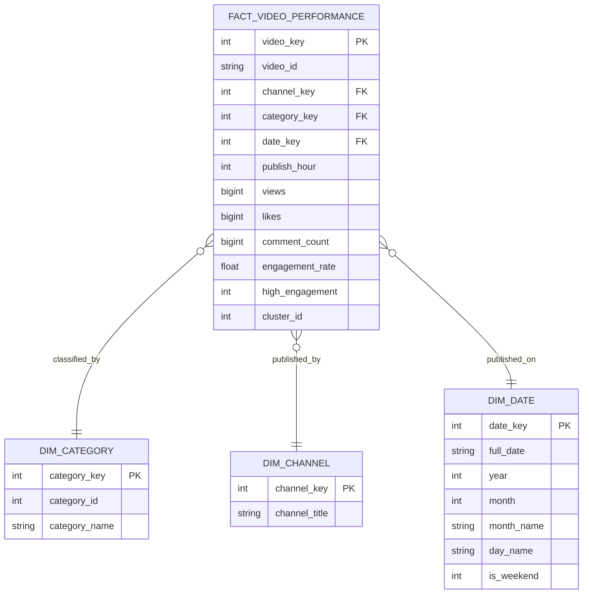

# Engineering and Scientific Methodology: YouTube Video Analytics

**Course:** Data Mining & Data Warehousing (BCI24505D)  
**Topic 42:** YouTube Video Analysis  
**Standard Framework:** Cross-Industry Standard Process for Data Mining (CRISP-DM)

---

## 1. Research Framework & CRISP-DM Mapping

This project adheres to the standard CRISP-DM lifecycle:

### Stage 1: Domain & Problem Understanding
Online video platforms operate within algorithmic attention economies. YouTube's recommendation engine balances click-through probability with viewer satisfaction signals. The objective of this project is to mine historical video metadata to uncover factors associated with high views, likes, comments, and engagement rates.

### Stage 2: Data Understanding
- Ingestion of 37,352 trending snapshots from Kaggle India dataset (`INvideos.csv`).
- Inspection of 16 raw features, identification of missing textual attributes (`description`), and assessment of temporal formatting.

### Stage 3: Data Preparation & Preprocessing
- **Missing Value Strategy:** Missing descriptions imputed with empty strings to preserve video records without biasing text length metrics.
- **Snapshot Deduplication:** Trending videos appear across multiple consecutive dates. For unbiased video-level cross-sectional analysis, snapshots are sorted by view count descending and deduplicated by unique `video_id`, retaining the peak-performance snapshot.
- **Filtering:** Erroneous or zero-view records removed.
- **Temporal Decomposition:** Parsing UTC timestamps into Year, Month, Day, Hour, and Day-of-Week components.
- **Feature Engineering:**
  - Engagement Rate: $((\text{Likes} + \text{Comments}) / \text{Views}) \times 100$
  - Like Ratio: $(\text{Likes} / \text{Views}) \times 100$
  - Comment Ratio: $(\text{Comments} / \text{Views}) \times 100$
  - Dislike Ratio: $(\text{Dislikes} / \text{Views}) \times 100$
  - Metadata Text Lengths: Title character length, Description length, and Tag Count.
  - Log Transformations: Applied natural $\log(1 + x)$ to `views`, `likes`, `dislikes`, and `comment_count` to compress heavy right-tail skewness.

---

## 2. Unsupervised Mining: K-Means Clustering Methodology

### Mathematical Formulation
Given a set of $n$ video observation vectors $X = \{x_1, x_2, \dots, x_n\} \subset \mathbb{R}^d$, K-Means partitions the observations into $k$ clusters $S = \{S_1, S_2, \dots, S_k\}$ so as to minimize the Within-Cluster Sum of Squares (WCSS / Inertia):

$$\text{WCSS} = \sum_{i=1}^{k} \sum_{x \in S_i} \|x - \mu_i\|^2$$

where $\mu_i$ is the centroid of cluster $S_i$.

### Feature Space Selection
To avoid having Euclidean distance dominated entirely by multi-million view outliers, feature scaling and log transformations are mandatory:
$$X = [\log(1 + \text{views}), \log(1 + \text{likes}), \log(1 + \text{comments}), \text{engagement\_rate}]$$

Features are standardized using `StandardScaler`:
$$z = \frac{x - \mu}{\sigma}$$

### Optimal Cluster Selection ($k$)
1. **Elbow Method:** Computing inertia across $k \in [2, 8]$. An elbow inflection point is evaluated where the rate of decrease in inertia slows substantially.
2. **Silhouette Coefficient:** Evaluates cluster cohesion and separation:
   $$s(i) = \frac{b(i) - a(i)}{\max(a(i), b(i))}$$
   where $a(i)$ is the mean intra-cluster distance and $b(i)$ is the mean nearest-cluster distance.

---

## 3. Supervised Mining: Decision Tree Classification (Zero Data Leakage)

### Mathematical Formulation
The Decision Tree builds an explainable hierarchical tree by recursively partitioning the feature space using the Gini Impurity criterion:

$$I_G(p) = 1 - \sum_{i=1}^{C} p_i^2$$

where $p_i$ is the probability of class $i$ at a given node.

The feature split that maximizes Information Gain (reduction in Gini impurity) is selected at each step:
$$\Delta I_G = I_{G}(\text{parent}) - \left( \frac{N_{\text{left}}}{N} I_G(\text{left}) + \frac{N_{\text{right}}}{N} I_G(\text{right}) \right)$$

### Zero Data Leakage Policy
To ensure model validity in a real-world setting, all post-upload response metrics are strictly forbidden as input features:
- **Excluded Features:** `views`, `likes`, `dislikes`, `comment_count`, `engagement_rate`, `like_ratio`, `comment_ratio`.
- **Allowed Predictor Features:** `publish_hour`, `publish_weekday`, `title_length`, `tag_count`, `desc_length`, and one-hot encoded `category_name` dummies.
- **Target Variable ($y$):** Binary classification indicating High Engagement ($y=1$ if engagement rate $\ge$ median, else $0$).

### Regularization and Hyperparameter Pruning
To prevent overfitting on idiosyncratic text lengths:
- `max_depth = 4`: Ensures trees remain human-interpretable for management and viva defense.
- `min_samples_leaf = 25`: Prevents splits on small, non-generalizable sample pockets.
- Stratified 80/20 train/test split.

---

## 4. Dimensional Modeling (Star Schema) Methodology

Analytical processing relies on dimensional modeling rather than transactional third-normal-form (3NF) relational structures.

### Why Star Schema for Data Warehousing?
1. **Query Simplicity:** Denormalized dimension tables reduce the number of joins required for aggregations.
2. **Predictable Query Performance:** Read-heavy OLAP queries perform rapid aggregations over indexed foreign keys.
3. **Decoupled Attributes:** Temporal, organizational (channel), and taxonomic (category) dimensions can be updated independently without affecting numeric historical measures in the fact table.

