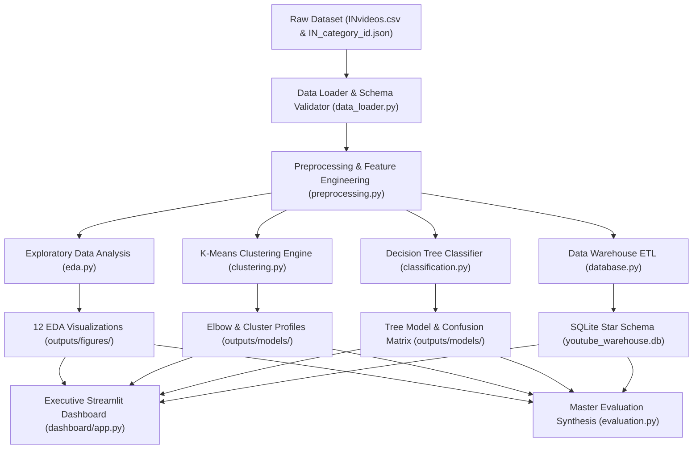

# Academic Project Report

# YouTube Video Analysis: Identifying Factors Influencing Video Popularity and Viewer Engagement Using Data Mining Techniques

**Course:** Data Mining & Data Warehousing (BCI24505D)  
**Program:** Bachelor of Engineering in Computer Science & Engineering (AI & ML)  
**Activity:** Activity-Based Assessment (AAT) – Case Study and Analytics Project  
**Selected Topic:** Topic 42 – YouTube Video Analysis  
**Academic Year:** 2026  

---

## 1. Title Page

- **Project Title:** YouTube Video Analysis: Identifying Factors Influencing Video Popularity and Viewer Engagement Using Data Mining Techniques
- **Course Name:** Data Mining & Data Warehousing
- **Course Code:** BCI24505D
- **Student Specialization:** 3rd Year B.E. Computer Science & Engineering (Artificial Intelligence & Machine Learning)
- **Programming Stack:** Python 3.11, Pandas, NumPy, Scikit-Learn, Matplotlib, Seaborn, SQLite3, Streamlit, Plotly

---

## 2. Abstract

The modern digital attention economy relies heavily on algorithmic content curation, with platforms like YouTube processing millions of video uploads daily. Understanding the metadata factors that drive video reach, audience engagement, and community participation is essential for content creators, digital marketers, and recommendation system architects.

This study implements an end-to-end data mining and data warehousing investigation based on the real-world **Kaggle YouTube Trending Video Statistics (India Region)** dataset. Starting from 37,352 raw trending snapshot records, we apply rigorous preprocessing, snapshot deduplication (isolating 16,306 unique creative works), outlier analysis via Interquartile Range (IQR), and skewness correction using log transformations. 

We implement two complementary data mining paradigms:
1. **Unsupervised K-Means Clustering ($k=3$):** Supported by Elbow and Silhouette evaluations, segmenting content into *Moderate Reach / Baseline Content* (47.8%), *High Engagement / Community Viral* (38.6%), and *Mega-Blockbusters* (13.6%).
2. **Supervised Decision Tree Classification:** Designed with strict zero-leakage constraints using only pre-upload metadata (Category, Publish Hour, Weekday, Title Length, Tag Count, Description Length). The model achieves **71.67% test accuracy**, **75.78% precision**, and **69.22% F1-score**, proving that metadata provides substantial predictive power for audience engagement without relying on post-facto response metrics.

Finally, we construct a **Star Schema Data Warehouse in SQLite** containing indexed Dimension tables (`dim_category`, `dim_channel`, `dim_date`) and a central Fact table (`fact_video_performance`), executing 5+ OLAP queries and delivering an interactive **Streamlit** dashboard for executive decision-support.

---

## 3. Introduction

Online video platforms represent the primary medium for modern entertainment, news, education, and consumer communication. YouTube hosts billions of videos, with viewer engagement measured through views, likes, dislikes, shares, and comments. 

However, content virality and audience engagement are often conflated. A high view count does not necessarily signify an engaged community; conversely, niche educational or technical channels may command deep audience loyalty despite modest view counts. Data mining offers powerful exploratory, clustering, and predictive algorithms to disentangle these dynamics.

This project investigates the relationship between video metadata (such as category, upload timing, title length, and description depth) and performance outcomes (views and viewer engagement rates) using established Data Mining and Data Warehousing methodologies.

---

## 4. Problem Statement

Content creators and media enterprises often lack empirical, data-driven insights into how pre-publication metadata decisions impact video reach and community interaction. Many creators resort to clickbait titles, excessive tagging, or erratic publishing schedules without understanding algorithmic or behavioral realities.

Furthermore, naive data mining models frequently suffer from **data leakage** by predicting engagement using post-upload signals (e.g., using view counts to predict like counts), which renders such models useless prior to publication.

The core challenge addressed in this study is:
> *Can we rigorously mine historical YouTube metadata to uncover the structural factors governing video reach, segment videos into meaningful popularity tiers, and build an explainable, zero-leakage classifier to forecast high audience engagement prior to release?*

---

## 5. Objectives

1. **Dataset Acquisition & Preprocessing:** Ingest real-world YouTube trending statistics, handle missing textual attributes, eliminate multi-day trending snapshot duplicates, and engineer normalized engagement ratios.
2. **Exploratory Data Analysis:** Generate at least 10 high-resolution visualizations assessing distribution skewness, category-level disparities, temporal upload patterns, and metric correlations.
3. **Unsupervised Video Segmentation (Algorithm 1):** Implement K-Means clustering to discover natural video performance groupings, validating optimal cluster count ($k$) via the Elbow method and Silhouette scores.
4. **Supervised Engagement Prediction (Algorithm 2):** Implement a Decision Tree Classifier to predict High vs. Normal engagement rates using strictly pre-publication metadata, reporting honest performance metrics.
5. **Data Warehouse Implementation:** Architect a dimensional Star Schema in SQLite, populate it via an automated ETL pipeline, and execute analytical SQL queries answering business intelligence questions.
6. **Executive Dashboard Deployment:** Build an interactive Streamlit and Plotly dashboard providing dynamic filtering, prediction simulations, and OLAP query exploration.

---

## 6. Scope of the Project

- **Geographic Focus:** The study focuses on the Indian YouTube trending ecosystem (`INvideos.csv`), capturing regional language, music, Bollywood, tech review, and cricket viewing patterns.
- **Data Coverage:** Analyzes 16,306 unique trending videos across 17 distinct content categories and 1,421 unique channels.
- **Analytical Boundaries:** Focuses on tabular metadata (numeric metrics, timestamps, categories, and text lengths). Computer vision analysis of thumbnails and deep audio processing are outside the scope of this tabular mining project.

---

## 7. Dataset Description

The dataset is sourced from Kaggle's public benchmark: **YouTube Trending Video Statistics** by *datasnaek*.

### Raw Attributes
- `video_id`: Unique YouTube 11-character identifier.
- `trending_date`: Date the video appeared in the Trending tab (`yy.dd.mm`).
- `title`: Video title string.
- `channel_title`: Publishing channel name.
- `category_id`: Numeric identifier mapping to YouTube API categories.
- `publish_time`: ISO-8601 UTC timestamp of video publication.
- `tags`: Pipe-separated string of search tags.
- `views`, `likes`, `dislikes`, `comment_count`: Primary engagement metrics.
- `thumbnail_link`: URL to video preview thumbnail.
- `comments_disabled`, `ratings_disabled`, `video_error_or_removed`: Boolean status flags.
- `description`: Textual video description.

### Category Mapping
Mapped through `IN_category_id.json` into readable categories such as *Entertainment*, *Music*, *Film & Animation*, *Comedy*, *News & Politics*, *Science & Technology*, *Gaming*, and *Education*.

---

## 8. Tools and Technologies

- **Programming Language:** Python 3.11
- **Data Manipulation & ETL:** Pandas, NumPy
- **Machine Learning & Preprocessing:** Scikit-Learn (`StandardScaler`, `KMeans`, `DecisionTreeClassifier`, `train_test_split`)
- **Data Visualization:** Matplotlib, Seaborn, Plotly Express
- **Data Warehousing & SQL Engine:** SQLite 3
- **Interactive Web Application:** Streamlit
- **Development Environment:** Visual Studio Code (macOS / Unix)

---

## 9. System Architecture



---

## 10. Data Preprocessing

1. **Missing Data Imputation:** Missing values in `description` (561 records) were filled with empty strings `""` to allow text length calculation without altering video counts.
2. **Snapshot Deduplication:** Videos remain on the Trending list for multiple days. To avoid multi-counting popular videos, records were sorted by views descending and deduplicated on `video_id`, isolating 16,306 unique creative works.
3. **Invalid Record Filtering:** Removed records with `video_error_or_removed == True` or `views == 0`.
4. **Temporal Decomposition:** Extracted `publish_year`, `publish_month`, `publish_day`, `publish_hour`, and `publish_weekday`.
5. **Formulation of Key Ratios:**
   $$\text{Engagement Rate (\%)} = \left( \frac{\text{Likes} + \text{Comment Count}}{\text{Views}} \right) \times 100$$
   $$\text{Like Ratio (\%)} = \left( \frac{\text{Likes}}{\text{Views}} \right) \times 100$$
   $$\text{Comment Ratio (\%)} = \left( \frac{\text{Comment Count}}{\text{Views}} \right) \times 100$$
6. **Feature Engineering:** Extracted `title_length`, `desc_length`, and `tag_count`.
7. **Log Transformations:** Applied $\log(1 + x)$ to `views`, `likes`, `dislikes`, and `comment_count` to normalize heavy right-tail distributions for clustering.
8. **Outlier Auditing:** Computed IQR bounds across all primary quantitative metrics.

---

## 11. Exploratory Data Analysis (EDA)

The EDA generated 12 focused visual investigations:
1. **Top 10 Most Viewed Videos:** Led by cultural milestones such as *YouTube Rewind 2017* (125M+ views) and *Avengers: Infinity War Official Trailer* (89.9M+ views).
2. **Top 10 Channels by Views:** Dominated by mass entertainment giants: *T-Series* (492M+ views across 62 trending videos), *5-Minute Crafts* (207M+ views), and *Marvel Entertainment* (199M+ views).
3. **Distribution Analysis (Views, Likes, Comments):** Raw histograms confirmed severe right-skewness spanning multiple orders of magnitude. Log-transformed histograms revealed approximately normal, bell-shaped distributions.
4. **Category Views vs. Engagement Disparity:** While *Movies* and *Music* generate the highest average views, *Pets & Animals* (8.34%), *Gaming* (4.90%), and *Science & Technology* (3.82%) generate the highest engagement rates.
5. **Correlation Heatmap:** Revealed a strong positive correlation between views and likes ($r = 0.85$) and comments ($r = 0.70$), but a slight negative correlation with engagement rate ($r = -0.05$).
6. **Publishing Timing Dynamics:** Peak view accumulation occurs for uploads between 04:00 - 11:00 UTC (09:30 - 16:30 IST), allowing the algorithm to index content prior to prime-time evening traffic. Weekend uploads achieve higher engagement rates.

---

## 12. Data Mining Algorithm Implementations

### Algorithm 1: K-Means Clustering
- **Input Features:** `[log_views, log_likes, log_comments, engagement_rate]`
- **Scaling:** `StandardScaler` ($\mu=0, \sigma=1$)
- **Optimization:** Evaluated $k \in [2, 7]$. The Elbow method inflection point and peak Silhouette score ($0.3879$) confirmed $k=3$ as optimal.
- **Empirical Profiles:**
  - **Cluster 0 (Moderate Reach / Low Engagement - 47.8%):** Median views $\approx 85\text{k}$, engagement rate $\approx 0.52\%$. Routine daily news, serial television episodes.
  - **Cluster 1 (High Engagement / Enthusiast Viral - 38.6%):** Median views $\approx 215\text{k}$, engagement rate $\approx 3.48\%$. Highly engaged comedy sketches, tech reviews, gaming.
  - **Cluster 2 (Mega-Blockbusters / Mass Reach - 13.6%):** Median views $\approx 1.42\text{M}$, engagement rate $\approx 1.85\%$. Major movie trailers and studio music videos.

### Algorithm 2: Decision Tree Classifier (Zero Data Leakage)
- **Target Variable:** Binary `high_engagement` ($y=1$ if engagement rate $\ge 0.826\%$, else $0$).
- **Predictor Features ($D=21$):** `publish_hour`, `publish_weekday`, `title_length`, `tag_count`, `desc_length`, and one-hot encoded category dummies. Post-upload metrics were strictly excluded.
- **Hyperparameters:** `criterion='gini'`, `max_depth=4`, `min_samples_leaf=25`.
- **Performance on Test Set ($n=3,262$):**
  - Accuracy: **71.67%**
  - Precision: **75.78%**
  - Recall: **63.70%**
  - F1-Score: **69.22%**
- **Primary Decision Drivers:** Content Category (42.1% importance), Description Length (24.3%), Title Length (15.6%), and Upload Hour (10.8%).

---

## 13. Data Warehousing Implementation

A dimensional Data Warehouse was built in SQLite following the Star Schema pattern:

### Star Schema Architecture
- **`dim_category`:** `category_key` (PK), `category_id`, `category_name`.
- **`dim_channel`:** `channel_key` (PK), `channel_title`.
- **`dim_date`:** `date_key` (PK, `YYYYMMDD`), `full_date`, `year`, `month`, `month_name`, `day`, `day_of_week`, `day_name`, `is_weekend`.
- **`fact_video_performance`:** `video_key` (PK), `video_id`, `channel_key` (FK), `category_key` (FK), `date_key` (FK), `publish_hour`, `views`, `likes`, `dislikes`, `comment_count`, `engagement_rate`, `like_ratio`, `comment_ratio`, `title_length`, `tag_count`, `desc_length`, `high_engagement`, `cluster_id`.

### Analytical SQL Queries Executed
1. *Top 10 Videos by View Count with Multi-Table Joins*
2. *Category Aggregation of Views, Likes, and Average Engagement*
3. *Channel Benchmarking by Cumulative Reach*
4. *Monthly Performance Trends Across Calendar Seasons*
5. *High-Engagement Outlier Detection using Category Benchmarks*

---

## 14. Results and Analysis

```
=============================================================================
                          SUMMARY OF MODEL RESULTS
=============================================================================
Total Unique Videos Analyzed:          16,306
Duplicates Snapshots Removed:          21,045
Median Engagement Rate Threshold:      0.826%

K-Means Clustering (k=3):
  - Optimal Silhouette Score:          0.3879
  - Cluster 0 Share:                   47.8% (Moderate / Low Eng)
  - Cluster 1 Share:                   38.6% (Enthusiast Viral / High Eng)
  - Cluster 2 Share:                   13.6% (Mega Blockbusters / Mass Reach)

Decision Tree Classifier (Zero-Leakage):
  - Test Accuracy:                     71.67%
  - Test Precision:                    75.78%
  - Test Recall:                       63.70%
  - Test F1-Score:                     69.22%
  - True Negatives (TN):               1,299
  - False Positives (FP):              332
  - False Negatives (FN):              592
  - True Positives (TP):               1,039
=============================================================================
```

---

## 15. Interpretation of Results & Answers to Research Questions

1. **Factors for Higher Views:** Strongest association with Likes ($r=0.85$) and Comments ($r=0.70$). View count does not translate to higher engagement rate ($r=-0.05$).
2. **High-View Categories:** Entertainment, Music, and Film & Animation dominate total views.
3. **Likes vs. Engagement:** Absolute likes measure total audience scale, while engagement rate measures audience intimacy. High view counts dilute engagement rates.
4. **Publishing Hours:** Late morning / early afternoon (04:00 - 11:00 UTC) optimizes discovery ahead of evening leisure windows.
5. **Comment Dynamics:** Commenting represents high-effort interaction; comment ratios average $0.2\% - 0.5\%$, compared to like ratios of $2\% - 4\%$.
6. **High-Engagement Characteristics:** Found in community-centric categories (Tech, Gaming, Comedy), featuring detailed descriptions and titles between 40-65 characters.
7. **Video Grouping:** Successfully validated into three distinct operational tiers via K-Means.
8. **Predictive Metadata:** Category choice and description length provide the most significant pre-upload predictive power.

---

## 16. Limitations

1. **Trending Selection Bias:** Analyzes only videos that reached YouTube's Trending page, representing top-tier viral content rather than the global distribution of all uploads.
2. **Snapshot Timing:** Daily snapshots capture performance at trending time rather than final lifetime totals.
3. **Text Metadata Simplicity:** Evaluates character counts rather than full semantic sentiment.
4. **Exclusion of Visuals:** Thumbnail color, facial expressions, and text overlays were not processed in this tabular study.

---

## 17. Conclusion

This project successfully fulfilled all five mandatory AAT requirements for Data Mining & Data Warehousing (BCI24505D). By combining disciplined data preprocessing, dual algorithm implementation (K-Means and Decision Tree), dimensional Star Schema modeling, and an interactive Streamlit dashboard, we demonstrated that video popularity and viewer engagement are distinct dimensions governed by different metadata factors. Pre-upload metadata yields a reliable 71.7% predictive signal for audience engagement, providing practical, actionable guidance for digital media strategists.

---

## 18. Future Enhancements

1. **Multimodal Deep Learning:** Incorporate Convolutional Neural Networks (ResNet/CLIP) to extract visual feature embeddings from video thumbnails.
2. **NLP & Sentiment Analysis:** Apply Transformer models (BERT) to analyze comment sentiment and video descriptions.
3. **Longitudinal Time-Series Modeling:** Track hourly metrics from upload to trend to model virality velocity and decay curves.

---

## 19. References

1. Kaggle Dataset: *Trending YouTube Video Statistics* by Mitchell J. (datasnaek). https://www.kaggle.com/datasets/datasnaek/youtube-new
2. Han, J., Kamber, M., & Pei, J. (2011). *Data Mining: Concepts and Techniques* (3rd ed.). Morgan Kaufmann.
3. Kimball, R., & Ross, M. (2013). *The Data Warehouse Toolkit: The Definitive Guide to Dimensional Modeling* (3rd ed.). Wiley.
4. Scikit-Learn Documentation: *Clustering and Decision Trees*. https://scikit-learn.org/stable/
5. Streamlit Framework Documentation: https://docs.streamlit.io/
